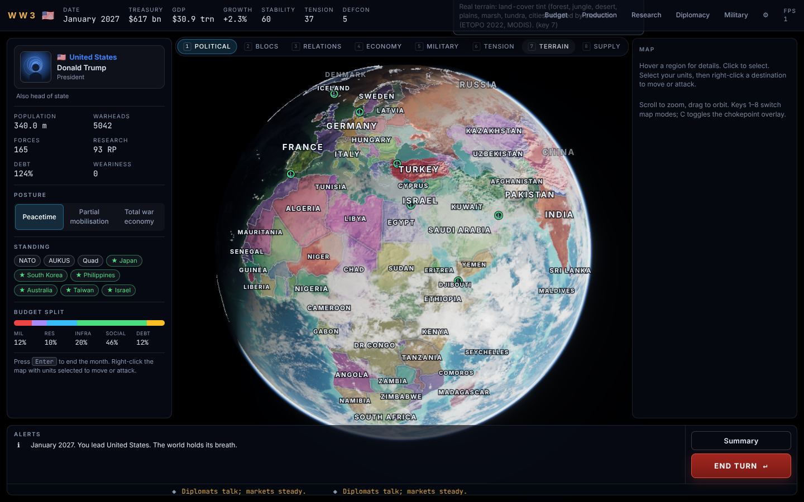

# World War 3

A turn-based near-future grand strategy game (Civilization meets Hearts of Iron) on a photoreal
3D globe. One turn is one month, the campaign starts in January 2027, and you can play any of the
14 major powers: USA, China, Russia, India, UK, France, Germany, Japan, South Korea, Iran, Israel,
Turkey, Pakistan and Brazil. The design brief is in [`docs/DESIGN.md`](docs/DESIGN.md), project rules
in [`CLAUDE.md`](CLAUDE.md), and decisions, data sources and the performance budget in
[`docs/`](docs/).

> This is a fictional simulation. Nations, leaders and events are simulated from public data (IMF,
> SIPRI, FAS, Natural Earth, NASA) and editorial estimates; real people appear only as names, titles
> and trait scores derived from the public record. Nothing here predicts or advocates anything.



## Play it on your Mac

Requirements: macOS on Apple silicon (the target is an M3 with 8 GB), a current Chrome or Safari, Git
(from Xcode Command Line Tools: `xcode-select --install`) and **Node.js 22.12 or newer**.

1. Install Node 22 if you don't have it:

   ```bash
   brew install node@22 && brew link --overwrite --force node@22
   ```

   or with [nvm](https://github.com/nvm-sh/nvm) (the repo has an `.nvmrc`):

   ```bash
   nvm install 22 && nvm use 22
   ```

2. Clone and install:

   ```bash
   git clone https://github.com/clindsayusc-unc/WW3.git
   cd WW3
   npm install
   ```

3. Run the game:

   ```bash
   npm run dev
   ```

   Open **http://localhost:5173**. For the optimised build: `npm run build && npm run preview`, then
   open **http://localhost:4173**.

All map data and textures are committed, so the game runs offline. Rebuilding them from the
original sources (Natural Earth, NASA, IMF, World Bank) is optional: `npm run build:map`,
`npm run build:textures`, `npm run build:nations`.

## How to play

1. **New Game** → pick a scenario (_World of 2027_ or _Taiwan Strait Crisis_) and a nation from the
   leader cards.
2. Each month: read the alerts and news ticker, set your **Budget** (B), queue **Production** (P),
   pick **Research** (R), talk to other nations in **Diplomacy** (D) and review your forces in
   **Military** (M): strength by domain against your rivals, air-wing missions, missile strikes,
   cyber operations, spies and satellites. Then press **End Turn** (Enter).
   Map mode 8 shows the supply network and who controls each sea zone; enemy forces appear only as
   far as your intelligence reaches; a battle alert opens the full battle report.
3. **Move or attack**: click a region with your units, click the stack in the right-hand panel to
   select it, then right-click a destination. The panel shows the estimated odds before you commit.
   You can only enter regions of nations you are at war with. Marines and special forces can cross a
   sea zone you control.
4. **Win** by hegemony (your bloc holds 55% of world GDP), conquest (every rival major capitulates),
   diplomacy (pass a World Order Resolution with a dominant bloc) or deterrence (reach January 2040
   as the top power without a nuclear war). Lose by capitulation, regime collapse or a full nuclear
   exchange, which nobody wins.

Every number in the interface has a tooltip explaining where it comes from. Settings (⚙) has
Master, Effects and Music volume sliders; the ambient music bed is off by default and fades in when
you switch it on.

### Controls

| Input                   | Action                                                             |
| ----------------------- | ------------------------------------------------------------------ |
| Drag / scroll           | Orbit / zoom (full globe down to ~320 km)                          |
| Left click              | Select region or sea zone                                          |
| Right click             | Move/attack with the selected units                                |
| `Enter`                 | End turn                                                           |
| `1`–`8`                 | Map modes: political, blocs, relations, economy, military, tension, terrain, supply |
| `B` `P` `R` `D` `M` `S` | Budget, Production, Research, Diplomacy, Military, Summary         |
| `L`                     | Toggle labels                                                      |
| `Esc`                   | Close window / clear selection                                     |

Settings (⚙) has quality presets (Low/Medium/High, default High), sound, labels and clouds toggles,
named saves and JSON export/import. The game autosaves every turn to IndexedDB; **Continue** on the
main menu resumes it.

## Development

| Command                  | What it does                                                                                                                                                                                                                                    |
| ------------------------ | ----------------------------------------------------------------------------------------------------------------------------------------------------------------------------------------------------------------------------------------------- |
| `npm run dev`            | Vite dev server                                                                                                                                                                                                                                 |
| `npm run check`          | typecheck + lint + unit tests + production build (CI runs this)                                                                                                                                                                                 |
| `npm test`               | Vitest: determinism, economy bounds, combat monotonicity, AI order validity, 120-turn soak, data validation                                                                                                                                     |
| `npm run e2e`            | Playwright: new game as USA, every screen, war declaration + move order, 10 turns; Taiwan Strait Crisis as China for 50 turns; no console errors; screenshots in `docs/screenshots/`. Set `PW_CHROMIUM_PATH` if the bundled browser is missing. |
| `npm run perf`           | 20-second camera sweep; writes `docs/perf-last-run.json`                                                                                                                                                                                        |
| `npm run soak`           | Headless 60-turn simulation with timing and a world event log                                                                                                                                                                                   |
| `npm run build:map`      | Rebuild regions/sea zones/ID texture from Natural Earth                                                                                                                                                                                         |
| `npm run build:textures` | Rebuild globe textures from NASA imagery                                                                                                                                                                                                        |
| `npm run build:nations`  | Rebuild `data/nations.json` from the IMF/World Bank APIs                                                                                                                                                                                        |

Layout: `src/sim` (pure deterministic simulation, runs in a Web Worker), `src/render` (globe, layers,
units, camera), `src/ui` (React HUD and screens), `src/state` (zustand stores, worker bridge, saves),
`data/` (JSON with `source` + `asOf`), `scripts/` (data builds), `public/textures/`.

CI (GitHub Actions) runs `check` on every push, then the `e2e` job.
