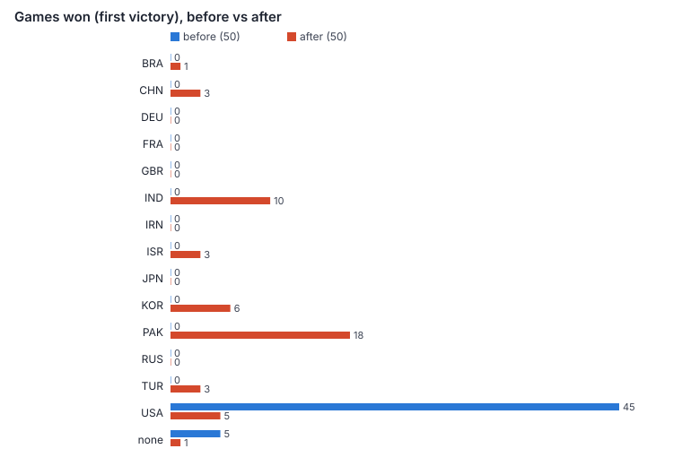
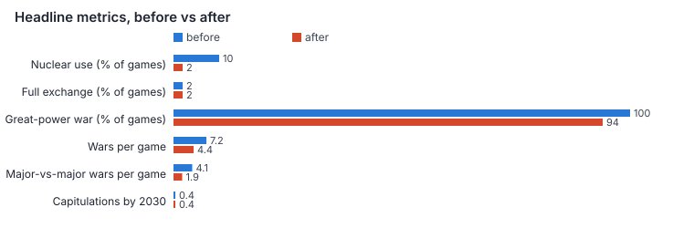
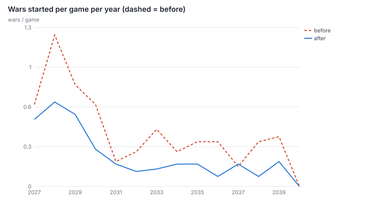
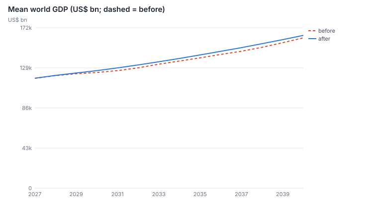
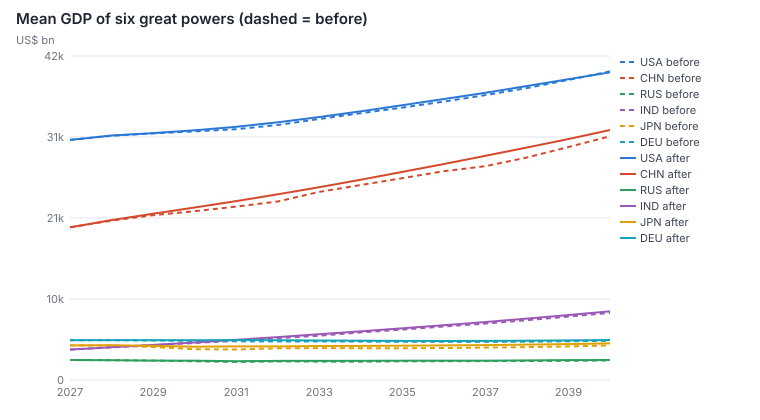
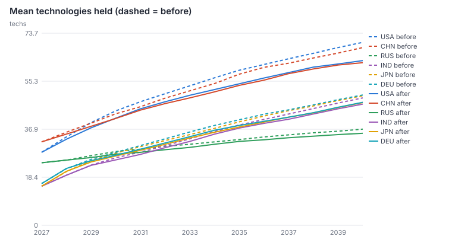

# Balance

Two parts: the all-AI self-play pass (D-081) and, below it, geography and the calibration
scenarios (D-050 – D-053, D-059, D-061, D-072).

## Self-play: 50 all-AI games before and after (D-081)

`npm run selfplay -- --games 50 --label <name>` (`scripts/selfplay.ts`) plays complete games from
January 2027 to January 2040 with every nation run by the AI (the nominal player is Tuvalu in
observer mode), three games at a time on worker threads, seeds 1–50. It records winners (every
great power's victory conditions checked each month), wars, nuclear use, capitulations, GDP,
technology and territory each January, units built, technologies researched, events fired, turn
times, NaN values and stuck states. Raw data: `docs/balance/before/`, `docs/balance/after/`
(`games.json`, `summary.json`, `summary.md`); charts: `docs/balance/compare/`
(`--compare before after`). Peak memory: 593 MB resident for the whole process with three
workers (≈ 110 MB heap per worker), well under the 2 GB budget.

"Before" is the code at the start of this pass with only observer mode and the per-nation victory
check added; "after" is the tuned game.

| Metric (50 games) | Before | After | Target |
| --- | --- | --- | --- |
| Games with any nuclear detonation | 10 % | **2 %** | < 10 % |
| Full nuclear exchange | 2 % | 2 % | — |
| Different great powers that win | 1 (USA 45, none 5) | **8** (PAK 18, IND 10, KOR 6, USA 5, CHN 3, ISR 3, TUR 3, BRA 1, none 1) | all 14 at least sometimes — **not met** (see below) |
| Wars started per game | 7.2 | 4.4 | wars happen |
| Games with a war between great powers' sides | 100 % | 94 % | |
| Capitulations by 2030 (any / great powers) | 0.4 / 0 | 0.4 / 0 | world does not collapse by 2030 |
| World GDP 2027 → 2030 → 2040 (US$ tn) | 118 → 124 → 161 | 118 → 126 → 164 | |
| Nations alive in 2040 | 195.4 | 195.1 | |
| Errors / NaN values | 0 / 0 | 0 / 0 | 0 |
| Stuck states (landless nations ≥ 12 months) | 21 | 1 | 0 |
| Frozen fronts (no region changes in 36 months) | 35 | 31 | (reported, not a bug) |
| Unit types never built | 6 | 1 (`fighter6`) | 0 |
| Technologies never researched by any AI | 7 | 13 | see research |
| World events never fired | 0 | 0 | 0 |

### What self-play found, and what changed

1. **Runaway winner: the United States, by definition.** Deterrence ("top GDP in 2040") went to the
   US in every game without a nuclear war; 12 of the 14 playable powers could never win it. It now
   goes to the great power that gained most **standing**: 0.5 × ln(output ÷ its own trend output)
   + 0.5 × ln((regions + 10) ÷ (2027 regions + 10)). The formula was chosen by re-scoring the
   finished games of intermediate tuned runs under each candidate (each run's yearly snapshots
   hold everything the score needs):

   | Candidate | Winners | Games scored |
   | --- | --- | --- |
   | Top GDP (old rule) | USA 45, none 5 | "before" run |
   | 0.5 economy + 0.3 military share + 0.2 territory | DEU 45 (rearming from a low base) | first tuned run |
   | 0.6 economy + 0.4 territory, undamped | PAK 11, BRA 7, IND 7, ISR 6, CHN 6, TUR 5, KOR 3, USA 2, FRA 1, GBR 1 | first tuned run |
   | 0.5 economy + 0.5 territory, damped by 10 regions | PAK 16, TUR 7, CHN 7, IND 6, ISR 4, BRA 4, USA 3, KOR 2 | second tuned run |
   | the same, final run | PAK 18, IND 10, KOR 6, USA 5, CHN 3, ISR 3, TUR 3, BRA 1 | "after" run |

   The military-share term was dropped: rearmament from a low base is cheap and an AI artefact.
2. **Suicidal event wars.** In a third of the games Iran answered the Gulf incident chain by
   attacking a US destroyer, which declared war on the US and brought every NATO member in under
   Article 5. Europe then spent years "at war" with Hormuz contested. Event choices that declare war
   are now weighted by (own strength ÷ target side's)²: Iran-declared wars on the US fell from 24 to
   2 per 50 games.
3. **Nuclear use** came mostly from India–Pakistan wars started by India against Pakistan's limited
   deterrent, and from Russia. Launch chance 0.25 → 0.12 a month once desperate; ×1.6 force ratio
   (was ×1.3) to attack a limited deterrent. 10 % → 2 % of games.
4. **Never-built units.** Bombers, carriers, SSBNs, amphibious groups, marines and special forces
   were never bought. All are now (carriers 29, SSBNs 23, amphibious 24, bombers 907 over 50
   games). The sixth-generation fighter is now unbuilt because no AI fields its technology before
   2040 (see research).
5. **Zombie states.** Lebanon survived with no land in 17 games after a peace left Israel holding
   it all; a landless nation at peace now capitulates to whoever holds its capital.
6. **Frozen fronts** (USA–Iran, Israel–Iran, Israel–Lebanon, China–Taiwan) are wars across water or
   with no reachable front that last years without a region changing hands. They are reported, not
   changed: they cost growth and weariness until peace.

### Why six great powers still never win AI-only games

Germany, France, the UK, Japan, Russia and Iran never topped the standing table. Their mean
economy runs 7–18 % below its own trend by 2040 (Japan −13 %, Germany −8 %, Russia −18 %), with
little game-to-game spread:

| | Economy vs trend, mean ± sd | Territory term |
| --- | --- | --- |
| Pakistan | −2.0 % ± 2.5 % | +0.08 ± 0.16 (wars on Afghanistan in 20 of 50 games) |
| Korea / Brazil / India | +3 % / +3 % / +1 % | ≈ 0 |
| United States / China | −4 % / −5 % | +0.03 |
| UK / Germany / France | −7 % / −8 % / −9 % | 0 |
| Japan / Iran / Russia | −13 % / −11 % / −18 % | ≈ 0 |

A growth decomposition of one game (seed 3) shows why: resource and trade shocks cost importers
1.4–3.0 pp a year (Germany resources −2.2, Japan trade −3.0, the US resources −1.4) — mostly oil and gas prices from US–Iran
wars (still 20 per 50 games, now US-initiated) contesting Hormuz, and sanctions on Russia — only
partly recovered by catch-up growth. Russia and Iran carry war and sanctions. A human playing these
powers can change those inputs (end the war, lift sanctions, secure energy, expand); the AI does
not. Making them win AI-only games would mean retuning the resource-shock model calibrated in
D-061, which is left for a separate pass.

### Research pace

The tree was shallow: an era-V technology was four techs from the US starting position. The
runner's **focused-research probe** plays the US or China as the player with a 30 % research budget,
always queueing the cheapest path to an era-V technology (`--probe`):

| Probe (seeds 1, 2) | Old tree | Era gate only | + premium 0.25 | Final |
| --- | --- | --- | --- | --- |
| US reaches era V | 2028.5 / 2028.1 | — | 2035.3 / 2035.2 | **2037.8 / 2037.8** |
| China reaches era V | 2028.8 / 2028.8 | — | 2035.8 / 2035.6 | **2038.5 / 2038.8** |
| US technologies after 5 years | 45 / 49 | — | 43 / 43 | **41 / 41** |

Final settings: an **era gate** (10 / 8 / 6 / 5 technologies of the previous era for eras II–V),
era costs × 1.15 / 1.4 / 1.65 / 1.85 for eras II–V, and an **ahead-of-its-time premium** of +45 % per
year before a technology's plausible fielding year. The AI (≈ 13–17 % research, not focused) now
holds 63 technologies in 2040 instead of 70 (US) and climbs toward the frontier; no AI reaches era V
by 2040, and 13 era-IV/V technologies are researched by no AI in 50 games — they are the reward for a
player who invests in research.

### Turn time

`scripts/soak.ts 156 USA` (full 13-year horizon, idle machine, one thread, Intel Xeon 2.1 GHz cloud
vCPU): **326 ms → 278 ms** a turn (60 turns: 319 → 273 ms). Fixes: the research cost model looped
over every nation for every nation (sanction share, export-control share, diffusion), now one pass
over the sanction lists and a per-month diffusion set; the supply search's heap swapped by array
destructuring (an allocation per swap). The self-play means (331 ms after; 544 ms before, measured
while an e2e run competed for the CPU) are with three games in parallel. Not measured on an M3:
its single-core speed is well above this vCPU's, so the M3 figure should sit comfortably under the
300 ms target, but that is an expectation, not a measurement.

---

## Geography and the calibration scenarios

How real geography shapes strategy in the simulation, the numbers behind it, and the scenario tests
that pin them (`src/sim/scenarios.test.ts`, `src/sim/geography.test.ts`). Values are game design;
the inputs they act on are real data (`docs/DATA_SOURCES.md`). Decisions D-050 to D-053.

### Terrain (`src/sim/terrain.ts`)

Each land region has a terrain class derived from ETOPO 2022 relief and MODIS land cover
(`data/terrain.json`, classifier documented in the file). The class sets:

| Terrain   | Defender × | Armour × | Infantry / special × | Air support × | Move cost | Supply loss / region |
| --------- | ---------- | -------- | -------------------- | ------------- | --------- | -------------------- |
| Plains    | 1.0        | 1.15     | 1.0 / 1.0            | 1.0           | 1.0       | 8 %                  |
| Desert    | 1.0        | 1.10     | 1.0 / 1.0            | 1.1           | 1.2       | 14 %                 |
| Forest    | 1.3        | 0.85     | 1.05 / 1.1           | 0.85          | 1.3       | 10 %                 |
| Hills     | 1.4        | 0.80     | 1.05 / 1.1           | 0.9           | 1.4       | 10 %                 |
| Marsh     | 1.5        | 0.60     | 1.0 / 1.1            | 0.9           | 1.8       | 15 %                 |
| Arctic    | 1.3        | 0.70     | 0.95 / 1.05          | 0.85          | 1.8       | 18 %                 |
| Jungle    | 2.0        | 0.50     | 1.0 / 1.15           | 0.6           | 2.0       | 20 %                 |
| Urban     | 2.0        | 0.60     | 1.1 / 1.15           | 0.75          | 1.1       | 6 %                  |
| Mountains | 2.5        | 0.50     | 1.0 / 1.15           | 0.6           | 2.2       | 22 %                 |
| Ice       | 1.5        | 0.50     | 0.9 / 1.0            | 0.8           | 3.0       | 30 %                 |

Mechanised formations take 60 % of the armour penalty, artillery 30 %. Supply loss is multiplied
by `1.4 − 0.8 × infrastructure` (road/rail density index), so a mountain region with no roads
loses ~31 % per hop and a motorway plain ~5 %.

### Crossings (`data/crossings.json`, `src/sim/geography.ts`)

Attacks across a border with a river along it pay ×0.75; across a mountain border ×0.7 (×0.8
through a named pass). Engineering tech (`crossing` modifier, "Combat Engineering & Bridging")
recovers up to half of the penalty. Units already inside the region — a bridgehead — pay nothing,
so the penalty bites on the first wave and disappears once a foothold is held. Crossings also add
movement cost (river +0.3, mountains +0.5, pass +0.3) and supply loss (+3 % / +6 %).

### Movement

A land unit has `speed` movement points a month (infantry 1, mechanised/armour 2). Entering a
region costs its terrain cost × weather × crossing. Progress banks across months, so infantry needs
three months to cross a mountain region in winter (2.2 × 1.8 ≈ 4) but one month on summer plains.

### Supply (`runSupply`)

Every region a nation owns and controls is a depot (level `0.8 + 0.2 × infrastructure`, reduced for
exclaves cut off from the capital). From depots, supply spreads along friendly land, losing the
terrain/infrastructure share per hop, and over sea zones from ports: 5 % per zone, +12–30 % where
enemy submarines hunt (halved by escorts), and capped on arrival by the destination port
(`0.35 + 0.15 × port capacity`; a bare beach caps at 35 %). Allies pass supply through their
territory. Units fight at `0.5 + 0.5 × supply`; below 25 % they are cut off (−4 strength/month).

### Oceans and power projection

- A landing needs sea control (friendly naval power ≥ hostile, at least one ship) in every zone on
  the route, the target must share a connected water body with the embarkation region, and the
  reach is 700 km for self-lifting marines/special forces, 2,000 km with amphibious lift.
- Amphibious groups carry two formations each per month (`liftCapacity`); marines and special
  forces lift themselves across one zone. Other formations wait for shipping.
- Assaulting a defended coast from the sea: ×0.5 (×0.7 with sea dominance and ≥ 60 % air
  superiority); defenders attacked only from the sea get ×1.3 (coastal defence).
- Convoys need zones without a commanding hostile fleet; submarines cut them.

### Strategic depth and seasons

Occupiers in hostile-owned regions suffer partisans: `(1.5 + 0.8 × depth) × 1.3` strength a
month in countries with ≥ 20 regions (×1.1 for ≥ 10), where depth is the number of land steps to
the nearest region the occupier (or an ally) both owns and controls. Recovery in occupied territory
runs at 35 % of the home rate and stops entirely in deep winter.

Weather comes from the MERRA-2 monthly climatology per region (`data/climate.json`): winter
`clamp(−T/15)`, monsoon `clamp((P − 150)/250)`, heat `clamp((T − 30)/10)`. Effects: attack
×(1 − 0.35 w)(1 − 0.3 m)(1 − 0.15 h); air support ×(1 − 0.25 w)(1 − 0.45 m); movement
×(1 + 0.8 w)(1 + 0.6 m)(1 + 0.25 h); attrition off own soil 8 w + 3 m + 4 h strength a month
(a quarter of that at home). Seasons follow the in-game month, so the southern hemisphere's winter
is July.

### Chokepoints (`data/chokepoints.json`, `updateChokepoints`)

Twelve straits. A shore controller at war can close one (the AI does so when an enemy depends on
it more than it does itself); submarines or destroyers in the strait can mine it. Closed straits
block hostile fleets and convoys; enemy naval dominance over every adjacent zone contests the
closure. Economics: the oil-price index rises by the strait's `oilShock` (Hormuz +60 %, Malacca
+25 %, Suez / Bab el-Mandeb +10 %, …); importers lose 3 pp of growth per +1.0 of index, exporters
gain 2 pp; nations listed as `dependents` lose `6 × share` pp while it is closed (half while
contested). Closing the Taiwan Strait or Malacca also cuts research speed by 15 % and raises
production costs for every nation without its own semiconductor industry.

### Calibration scenarios

Scripted campaigns on the real map with the real starting forces (plus documented additions where
the economy cap under-counts an army). The driver orders the attacker's stacks toward an objective
each month, attacking in front-width waves when the odds reach a threshold; everyone else is the
built-in AI. Numbers from the run on 2026-11-02 (seeded, deterministic).

| Scenario                                       | Result                                                                                                                                        | Assertion                                                                      |
| ---------------------------------------------- | --------------------------------------------------------------------------------------------------------------------------------------------- | ------------------------------------------------------------------------------ |
| US corps (24 formations, carriers in the Gulf) vs mobilised Iran (≈ 50 formations) | Khuzestan taken in month 1; no attack on the Zagros ever reaches 0.7:1 odds; the corps is ground down on the coast by heat, partisans and counter-attacks (2,400 → 507 strength over 18 months). | coast ≤ 6 months; Tehran ≥ 9 months or never; attacker losses > 250          |
| Invasion of the continental US                 | No sea route to California exists while the US Navy holds the Pacific (the uncontested route is > 3 zones); no Chinese unit can land anywhere in the US. A force granted total naval dominance and already ashore holds nothing after 12 months. | route null; no landing targets; ≤ 1 US region held; landed strength < 300     |
| Russia vs Baltics, no NATO (no troops, no aid) | Tallinn month 1, Riga month 2, Vilnius month 3.                                                                                                | ≥ 2 capitals, first within 3 months                                             |
| Russia vs Estonia with NATO pact               | 30 NATO members enter; Tallinn falls in month 2 but Russia loses 8 home regions to NATO counter-attacks within 4 months.                       | Tallinn holds, or Russia loses home regions, or its army shrinks 30 %           |
| China vs Taiwan (US fleet in the strait)       | No sea control, no landing possible.                                                                                                         | `hasSeaControl` false; Taipei not a landing target                              |
| China vs Taiwan (US stays out, PLAN controls strait) | Taipei falls in month 3 after 8 battles; 2,700 strength (≈ 27 formations) lost in 9 months.                                                   | losses > 1,500; Taipei ≥ 3 months                                               |
| KPA (≈ 48 formations incl. 4 SAM brigades) across the DMZ | Gyeonggi (urban) in month 5; Seoul still South Korean after 8 months; 18 battles, attacker −232, defender −73. Since D-072 the ROK AI holds Seoul with a standing garrison (capital defence) rather than counter-attacking the massed KPA corps, so the attacker pays far more than the defender. | Seoul ≥ 4 months; Gyeonggi ≥ 3 months; combined losses > 250; defender losses > 50; attacker loses more; ≥ 10 battles |
| Chinese army group two regions deep in Russia  | Winter (Dec–Mar): −2,257 strength in 4 months with one battle. Summer: −1,335 with four battles.                                              | winter losses > 1.5 × summer and > 1,200                                        |
| India vs China on the LAC / China vs India     | India never finds 0.6:1 odds against Tibet; China takes Ladakh in month 6 for 1,600 strength and nothing more.                                | each side ≤ 2 regions                                                           |

Why these ranges: the Gulf coast is flat and within reach of carrier air, so it should fall fast;
the Zagros (×2.5, armour ×0.5, air ×0.6, mountain border ×0.7, 22 % supply loss per hop) is where
numbers stop mattering. Crossing an ocean against a fleet is the hardest thing in the game by
design: without control of every zone there is no route, and a beach without a port cannot feed a
corps. The Baltics are small, flat and a day's drive from Russian depots; only the alliance changes
that. Taiwan is three regions of cities and mountains behind a strait, and Korea's border is a
conurbation. Siberia in January kills more soldiers than the Russians do. The Himalaya is a wall.

Tuning notes: the attacker in the Iran run never attacks because the driver's 0.7 threshold is
conservative; a human would probe at worse odds and lose faster. Partisan attrition is deliberately
mild per month and brutal over a year. If a future force-size pass raises Iran's and North Korea's
standing armies, remove the unit additions in the tests.

### Military depth (D-059)

- **Supply** now flows from depots (capital, industrial regions, major ports) instead of every
  owned region; home regions linked to the capital keep a floor of 55 %. Bombed infrastructure
  (`infraDamage`) adds to the per-hop loss, and enemy interdiction wings multiply the final level by
  0.85 per wing (floor 0.55). The calibration scenarios were unaffected because every battle region
  in them is a depot or one hop from one.
- **Air superiority** multiplies each side's firepower by 0.85 + 0.3 × its share of the air. Shares
  come from superiority wings (full weight), CAS wings (×0.4), other missions (×0.3), carriers
  (×0.5 one zone out) and ground anti-air (×0.5), cut by the terrain's `air` factor and the weather.
  The Korea scenario gained four KPA air-defence brigades so the SAM belt is represented; the KPA
  still never finds better than 0.2:1 against the ROK corps in urban Gyeonggi, and the fighting
  there now starts when that corps leaves for its counter-landing (two months of amphibious
  preparation instead of an instant hop), so the scenario pins combined losses (> 500), the
  month Gyeonggi falls (≥ 3) and the number of battles (≥ 10) rather than the attacker's losses
  alone.
- **Interception** of wings over defended regions: 5 × air-defence weight ÷ (air-power tech ×
  (1 + 0.6 × escorts)), capped at 25 strength a month; of missiles: 2.2 × missile-defence tech +
  0.12 per air-defence brigade (+0.1 with any tech), capped at 0.8, × (1 − strike tech).
- **Naval combat** uses K = 2 (land uses 3): fleets grind rather than annihilate, and withdrawing
  below 25 % keeps most groups alive to fight again. Commerce raiding is a growth drag, not a
  treasury hit, so its effect compounds slowly and is visible in the growth tooltip.
- **Experience** ranges ×0.95..×1.20, deliberately narrower than terrain or supply so veterans
  matter but never replace numbers; commanders are ±10 % and appear on a third of formations.

### Economy depth (D-061)

Constants live in `src/sim/economy.ts`, `src/sim/trade.ts` and `src/sim/domestic.ts`; the full
model is in D-061. Reference outcomes from headless runs (seed 1, player USA, passive):

- A year-long China–Taiwan war in which China contests the strait costs (output gap at the
  trough) the US ≈ 6 %, China ≈ 8 %, Japan ≈ 12 %, Taiwan ≈ 17 %, and recovers within two to three
  years of peace. An earlier calibration (shortage weights 4–7 pp, recovery capped at +5 pp) gave
  −16 % / −32 % for the US / Japan over a four-year war, about twice published estimates for a
  Taiwan war (e.g. Bloomberg Economics, 2024: US ≈ −7 %, China ≈ −17 %, Taiwan ≈ −40 %).
- A full Chinese blockade of Taiwan (all adjacent zones under Chinese control) leaves the US,
  Japan, Germany, the UK and India with under 75 % of their advanced-chip demand; fighter lines run
  at < 85 % speed and AI research at < 85 %; the chip price passes ×1.3 the next month.
- A Chinese rare-earth embargo on Japan alone is absorbed (Japan buys the non-Chinese supply:
  ≈ 89 % satisfied); an embargo on the whole G7 + Korea leaves them under 40 %.
- China sanctioning Japan cuts ≈ 215 bn of trade: Japan loses ≈ 2.9 pp of growth, China ≈ 0.7 pp
  (same loss, different GDP).
- 240-turn soak (seed 3): every nation stays within 6 %/yr compound decline and 11 %/yr compound
  growth, output within 40–130 % of potential, inflation −3…150 % (majors < 60 %), debt below the
  default line, treasury ≥ 0, prices 0.6–5.

### Ukraine with and without Western aid (D-072)

World of 2027, Brazil as a passive player, seeds 1–10, 24 months (`src/sim/ukraine-*.test.ts`).

| Condition | Result | Test bound |
| --- | --- | --- |
| Western aid (≈ US$ 7 bn/month at the start) | Kyiv held 24 months in 10 of 10 seeds; about half end in a negotiated peace along the front | ≥ 7 of 10 hold Kyiv |
| Every donor suspended | Kyiv lost in 4 of 10 seeds, in months 4–6; two capitulations | ≥ 3 of 10 lose Kyiv |

What holds Kyiv: aid formations (≈ 1–2 a month), munitions (supply and a ×1.1–1.2 combat
modifier), the capital-first defensive AI and the ×1.3 capital modifier. What loses it: Russian
corps staging through Belarus (Gomel borders the Kyiv region) while Ukraine's reserves are on the
eastern front.
